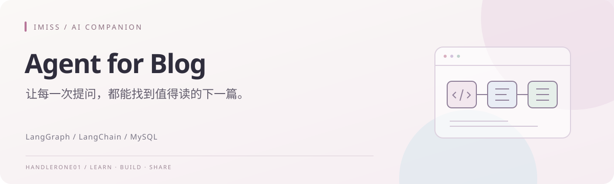
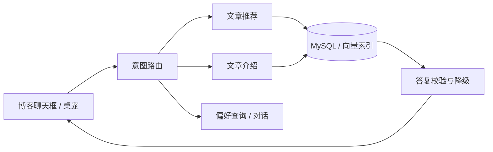

<div align="center">



<h1>Agent for Blog</h1>

<p><b>让每一次提问，都能找到值得读的下一篇。</b></p>

<p>  </p>

<p><a href="#功能速览">功能速览</a> · <a href="#工作流程">工作流程</a> · <a href="#快速开始">快速开始</a> · <a href="#用户上下文与多轮对话">接入说明</a> · <a href="./README.en.md">English</a></p>

</div>

---

一个基于 **LangGraph 和 LangChain** 的博客阅读助手，面向博客聊天框或桌宠对话场景。它可以根据用户需求推荐站内文章、讲解指定文章、记录阅读篇幅偏好，并以爱弥斯的人设进行日常对话。

项目使用 MySQL 保存文章元数据与正文，结合分类词匹配、向量召回和 SQL 查询获取候选文章，再生成带有站内链接的答复。当前仓库提供 Agent 后端与调试工具，博客页面和桌宠界面由接入方实现。

## 功能速览

<table>
  <tr>
    <td width="33%" valign="top"><b>01 / 理解需求</b><br /><br />推荐文章、讲解正文、查询偏好与日常对话，按意图进入对应流程。</td>
    <td width="33%" valign="top"><b>02 / 从真实内容回答</b><br /><br />结合分类词、向量与 SQL 检索，并校验文章标题和站内链接。</td>
    <td width="33%" valign="top"><b>03 / 延续一次对话</b><br /><br />通过中断等待补充条件或文章选择，按用户保存阅读篇幅偏好。</td>
  </tr>
</table>



> 本仓库提供 Agent 后端；博客页面与桌宠由 [IMiss Blog](https://github.com/HandlerOne01/IMiss_Blog) 接入。向量检索为可选能力，文章推荐和介绍需要可访问的 MySQL 文章库。

## 主要功能

- **意图路由**：区分文章推荐、指定文章介绍、偏好查询和普通对话。
- **文章推荐**：提取主题、栏目、标签、体裁、篇数与字数条件；没有明确字数要求时，不默认限制文章篇幅。
- **混合检索**：用分类词和别名收窄候选，结合向量相似度排序；召回不可用或结果不足时回落到数据库检索。
- **文章讲解**：通过标题、文章链接或向量候选定位文章，读取真实 Markdown 正文，生成简短介绍。
- **多轮澄清**：缺少推荐方向、文章重名或用户需要进一步介绍时，使用 LangGraph 中断等待回答。
- **阅读偏好记忆**：通过 LangGraph Store 按用户保存字数偏好，并提供偏好查询。
- **统一角色提示词**：由 `persona.txt` 管理爱弥斯的人设，面向用户的回复统一引用。
- **答复校验与降级**：检查文章标题、篇数和链接等约束；数据库或模型调用失败时返回提示或模板，避免带着无效结果继续执行。

## 工作流程

```text
用户消息 → 读取偏好 → 识别意图
                         │
          ┌──────────────┼──────────────┬──────────────┐
          ▼              ▼              ▼              ▼
       推荐文章        介绍文章        查询偏好        普通对话
          │              │              │              │
       提取需求       定位目标文章     读取已有信息     人设化回复
          │              │
   分类词 / 向量 / SQL   读取正文
          │              │
       生成并校验      按长度准备内容
          │              │
       推荐结果        生成并校验介绍
          │
   询问是否介绍其中一篇
          │ 用户选择序号
          └──────────→ 介绍文章
```

主图和三个子图均注册在 `langgraph.json` 中：

| 图名称 | 入口 | 用途 |
| --- | --- | --- |
| `blog_agent` | `src/agent/graph.py:graph` | 完整博客助手，推荐后可继续选择文章介绍 |
| `recommended_agent` | `src/agent/recommend.py:recommended_graph` | 单独调试推荐流程 |
| `introduce_agent` | `src/agent/introduce.py:introduce_graph` | 单独调试文章介绍 |
| `extend_agent` | `src/agent/extend.py:extend_graph` | 普通对话 |

## 目录结构

```text
agent_-for_-blog/
├── src/agent/
│   ├── graph.py             # 主图与意图路由
│   ├── recommend.py         # 推荐子图
│   ├── introduce.py         # 介绍子图
│   ├── extend.py            # 普通对话子图
│   ├── node/                # 各流程的节点实现
│   ├── state/               # 主图和子图状态定义
│   └── common/
│       ├── llm.py           # 共享模型与温度配置
│       ├── db.py            # 懒加载数据库连接、连接保活与异常处理
│       ├── retrieval.py     # 向量召回、分类词锚点与别名
│       ├── content.py       # 文章定位、元数据及正文查询
│       ├── context.py       # 用户运行时上下文
│       ├── store.py         # 用户偏好数据模型
│       ├── persona.py       # 人设加载与提示词组合
│       ├── persona.txt      # 爱弥斯人设
│       └── reply.py         # 降级答复与工具消息补全
├── scripts/
│   ├── load_blog.py         # Markdown 解析、建表和文章导入
│   ├── build_index.py       # 从数据库构建向量索引
│   └── ...                  # 数据检查、回归验证等辅助脚本
├── data/blog_index.json     # 随仓库提供的文章向量索引
├── tests/
│   ├── unit_tests/          # 路由、检索、答复、导入等回归测试
│   └── integration_tests/   # 集成测试目录
├── langgraph.json           # 图入口与环境文件配置
├── pyproject.toml           # 依赖与开发工具配置
├── uv.lock
├── .env.example
├── Makefile
└── LICENSE
```

## 环境要求

- **Python 3.11 或 3.12**：项目元数据声明 Python ≥ 3.10，但当前 [NumPy 依赖](https://pypi.org/project/numpy/2.3.4/)及 LangGraph 本地开发服务需要更高版本。
- **MySQL 8.0**：运行文章推荐与介绍需要文章库；导入脚本使用 MySQL 8.0 的排序规则与表结构。
- **支持工具调用的模型服务**：默认配置为 DeepSeek 的 `deepseek-chat`，使用 OpenAI 兼容接口。
- **Embedding 服务（可选）**：启用向量检索或重建索引时需要；缺少配置时推荐流程会回落到 SQL。

Python 版本与开发服务安装方式可参考 [LangGraph 本地服务文档](https://docs.langchain.com/oss/python/langgraph/local-server)。

## 快速开始

### 1. 获取代码与安装依赖

```bash
git clone https://github.com/HandlerOne01/agent_-for_-blog.git
cd agent_-for_-blog
python -m venv .venv
```

Linux / macOS：

```bash
source .venv/bin/activate
python -m pip install -e . "langgraph-cli[inmem]"
cp .env.example .env
```

Windows PowerShell：

```powershell
.\.venv\Scripts\python.exe -m pip install -e . "langgraph-cli[inmem]"
Copy-Item .env.example .env
```

Windows 后续命令中的 `python` 使用 `.\.venv\Scripts\python.exe`，`langgraph` 使用 `.\.venv\Scripts\langgraph.exe` 即可。

当前 `uv.lock` 仍保留模板时期的部分依赖记录，与 `pyproject.toml` 不一致。以上安装以当前项目依赖为准；使用 uv 时，应先更新锁文件，不要直接依赖旧锁文件进行冻结安装。

### 2. 配置环境变量

编辑项目根目录的 `.env`，填入自己的密钥与数据库连接信息。示例中的占位值需要替换：

```dotenv
DEEPSEEK_API_KEY=replace-with-your-api-key
DEEPSEEK_BASE_URL=https://api.deepseek.com/v1
DEEPSEEK_MODEL=deepseek-chat
DEEPSEEK_TEMPERATURE=0.8
DEEPSEEK_TEMPERATURE_DETERMINISTIC=0.0

DB_HOST=127.0.0.1
DB_PORT=3306
DB_USER=blog_reader
DB_PASSWORD=replace-with-your-db-password
DB_NAME=my_blog_rebuild

LANGSMITH_PROJECT=agent-for-blog
```

`DEEPSEEK_API_KEY` 在导入模型模块时检查，缺失会阻止图加载。数据库采用懒连接，但文章推荐和介绍仍需要可访问的文章库。

运行 Agent 建议使用只有读取权限的数据库账号；建表和导入时另用具备相应写入权限的账号。SQL 代理的查询限制来自提示词，数据库账号权限仍应与用途匹配。

需要向量检索时，再加入：

```dotenv
EMBEDDING_API_KEY=replace-with-your-embedding-key
EMBEDDING_BASE_URL=https://api.siliconflow.cn/v1
EMBEDDING_MODEL=Qwen/Qwen3-Embedding-8B
```

代码也兼容旧变量 `GuiJiLiuDong_API_KEY`。需要 LangSmith 跟踪时，可另外配置 `LANGSMITH_API_KEY` 和 `LANGSMITH_TRACING=true`。

按 `.env.example` 的约定，环境文件使用 ASCII 内容，注释单独成行；真实密钥只放在已被 Git 忽略的 `.env` 中。

### 3. 准备文章数据

如果已有兼容的文章库，可直接配置 `DB_NAME`。核心数据对象为：

| 对象 | 用途 |
| --- | --- |
| `blog` | 标题、分类、标签、字数、摘要、链接及发布状态 |
| `blog_content` | 以 `blog_id` 关联文章，保存 Markdown 正文、目录与内容哈希 |
| `v_blog` | 已发布文章视图，筛选 `status = 1` |

仓库未附带完整的博客 Markdown 源文件或数据库备份，需要提供自己的文章目录。导入脚本接受带 frontmatter 的 Markdown，示例：

```markdown
---
title: C++ 继承入门
category: C/C++
description: 介绍继承与派生类的基础用法。
tags: [C++, 继承]
published: 2026-01-01
draft: false
---

这里是文章正文。
```

先检查解析结果，把 `path/to/posts` 替换为自己的文章目录：

```bash
python -X utf8 scripts/load_blog.py --posts path/to/posts --dry-run
```

这个 `--dry-run` 只解析文件，不连接或写入数据库。确认结果后，使用具备建库与写入权限的账号导入到影子库：

```bash
python -X utf8 scripts/load_blog.py --posts path/to/posts \
  --database my_blog_rebuild --init-schema
```

默认按 `title + blog_url` 更新或插入，分批提交并支持断连重试。`--replace` 会先清空目标文章表，正常增量导入不需要该参数；生产库 `my_blog` 的写入需要脚本的显式开关。

脚本中的作者 `AUTHOR`、链接前缀 `BLOG_URL_PREFIX` 和默认文章路径带有作者博客的配置，接入自己的博客时应调整它们，或通过 `--posts` 指定输入目录。

### 4. 准备向量索引（可选）

仓库附带 `data/blog_index.json`，当前包含 138 条文章向量。它对应作者的文章数据；使用自己的数据库时应重建，确保索引文章 ID、向量模型与数据库一致。

```bash
# 读取数据库，查看待建索引文本，不调用 embedding 接口
python -X utf8 scripts/build_index.py --dry-run

# 调用 embedding 服务并覆盖 data/blog_index.json
python -X utf8 scripts/build_index.py
```

建索引文本包括标题、摘要、分类和标签。修改文章集合、模型或文本格式后需要重新构建索引，并复核召回阈值。

`build_index.py --dry-run` 仍会读取数据库，与文章导入脚本的 `--dry-run` 行为不同。

### 5. 启动本地服务

在仓库根目录运行：

```bash
langgraph dev
```

通常会输出本地 API 地址 `http://127.0.0.1:2024`、接口文档地址和 Studio 链接，以启动日志为准。打开 Studio，选择 `blog_agent`，输入消息即可调试。

可尝试这些请求：

- “推荐 3 篇 C++ 的八股文，字数不限。”
- “介绍一下《继承》这篇文章。”
- “我之前说过喜欢多长的文章？”
- “爱弥斯，今天学代码有点累。”

示例文章是否存在取决于数据库内容。`langgraph dev` 用于本地开发，部署时还需要配置持久化存储和博客前端接入。

## 用户上下文与多轮对话

阅读偏好保存在 `(user_id, "preferences")` 命名空间下。调用时通过 **runtime context** 传入 `user_id`；未传时使用 `anonymous`，不同访客应设置各自的用户标识。

会话 `thread_id` 用于保存对话状态和恢复中断，`user_id` 用于区分偏好，两者用途不同。直接在 Python 中调用图时，还需注入 Store，并为中断配置 checkpointer。

### API 调用示例

服务启动后，可用 LangGraph SDK 调用主图：

```bash
python -m pip install langgraph-sdk
```

```python
from langgraph_sdk import get_sync_client

client = get_sync_client(url="http://127.0.0.1:2024")
thread = client.threads.create()
thread_id = thread["thread_id"]
context = {"user_id": "demo-user"}

result = client.runs.wait(
    thread_id,
    "blog_agent",
    input={"messages": [{"role": "user", "content": "推荐 3 篇 C++ 文章"}]},
    context=context,
)
print(result)

# 出现澄清或选择问题时，由用户回答后恢复。
while result.get("__interrupt__"):
    for item in result["__interrupt__"]:
        print(item["value"])
    answer = input("你的回答：")
    result = client.runs.wait(
        thread_id,
        "blog_agent",
        command={"resume": answer},
        context=context,
    )
    print(result)
```

同一对话复用 `thread_id`；恢复中断时传入 `command.resume`，不要创建新会话替代恢复。服务端 API 的中断处理参见 [LangGraph 官方说明](https://docs.langchain.com/langsmith/add-human-in-the-loop)。

### 中断载荷

当前节点用结构化对象描述问题，例如：

```json
{
  "value": "要不要介绍其中一篇？回序号，不用就回「不用」。",
  "kind": "choice",
  "options": ["1", "2", "不用"],
  "default": null
}
```

`value` 用于展示问句；`kind`、`options` 和 `default` 用于客户端处理交互。推荐后选择文章的回答只识别序号；多篇同名文章的澄清还支持篇名匹配。选择题的 `default` 为 `null`，客户端应展示问题并等待用户选择。

## 检索与文章介绍

推荐检索组合了分类、标签和别名匹配、向量相似度及 SQL 条件筛选。当前向量原始召回不足 3 篇时回落 SQL；最终结果还会按发布状态、明确的字数条件和推荐篇数过滤。

向量召回参数在 `src/agent/common/retrieval.py` 中，包括 `RECALL_TOP_K=10`、`RECALL_SCORE_MIN=0.50`、`RECALL_ITEM_MIN=0.45` 和 `RECALL_SPREAD=0.15`。这些阈值与现有模型及语料有关，更换数据后不能直接视为通用参数。

介绍流程先定位目标文章，再读取 `blog_content.content`。短文使用全文，中等长度文章按预算准备内容，长文取开头及可用目录；当前实现没有分块摘要合并流程。

| 可选环境变量 | 默认值 | 含义 |
| --- | --- | --- |
| `INTRO_FULL_MAX` | `5000` | 短文长度上界 |
| `INTRO_MAP_MAX` | `50000` | 中等长度文章上界 |
| `INTRO_TOKEN_BUDGET` | `30000` | 中等文章字符预算按该值 × 1.5 估算 |
| `INTRO_LONG_HEAD` | `3000` | 长文取开头的字符数 |
| `INTRO_MATCH_GAP` | `0.05` | 向量候选过于接近时触发用户选择的差值 |

生成后校验标题与链接等约束，未通过时返回模板。正文缺失时会说明没有取到正文；数据库失败时相关流程会提前结束。

## 开发与验证

安装测试工具后运行单元测试：

```bash
python -m pip install pytest
python -m pytest tests/unit_tests
```

测试覆盖推荐澄清、主题锚点、向量回落、推荐转介绍、正文读取、输出校验和导入重试等场景。导入图的测试仍需要模型客户端能完成初始化，因此运行前应配置环境变量，并按测试文件说明确认哪些调用已使用 mock。

`tests/integration_tests` 中仍有模板示例，不能直接作为当前博客业务端到端可用的证明。`scripts/` 下部分验证工具会调用真实模型或数据库，运行前需查看各脚本说明。

## 常见问题

**启动时报未找到 `DEEPSEEK_API_KEY`**

确认 `.env` 位于项目根目录，变量名正确，并已填入有效密钥。替换模型服务时，需要同时配置兼容的模型名称、接口地址和密钥。

**数据库不可用时聊天还能进行，文章推荐却失败**

数据库连接采用懒加载，普通对话不必先连接文章库。推荐与介绍需要实际文章数据，连库失败会触发降级，请检查 `DB_*` 配置、账号权限和连接状态。

**提示缺少向量索引或 embedding key**

配置 `EMBEDDING_API_KEY`，并按自己的数据库重建索引；也可以先使用 SQL 回落。索引首次加载失败后会缓存失败状态，修复配置后需重启服务。

**推荐已经显示，但后续一直等待**

检查是否返回 `__interrupt__`。可能正在等待推荐方向、文章选择或介绍确认，需要在原会话中提交恢复命令。

**文章介绍没有完整覆盖长文**

检查长度档位与字符预算。长文目前只使用开头和可用目录，并不保证总结全文；可按模型上下文能力调整 `INTRO_*` 配置或进一步实现分块处理。

**角色语气没有生效**

确认 `src/agent/common/persona.txt` 存在并使用 UTF-8。人设在导入时加载，修改后需重载服务；文件缺失会发出警告并降级为空人设。

## 许可证

项目使用 [MIT License](LICENSE)，保留了原 LangGraph 模板的许可证声明。

## 相关项目

| 项目 | 这里负责什么 |
| --- | --- |
| [IMiss Blog](https://github.com/HandlerOne01/IMiss_Blog) | Astro + Svelte 个人技术博客，提供文章阅读与 AI 桌宠入口。 |
| [Agent for Blog](https://github.com/HandlerOne01/agent_-for_-blog) | LangGraph 博客助手，负责文章推荐、正文介绍与阅读偏好。 |
| [Boost Search Engine](https://github.com/HandlerOne01/search_engine) | C++ 文档搜索实践，学习分词、索引与结果排序。 |
| [Reactor Server](https://github.com/HandlerOne01/my_server) | C++ Linux 网络编程实践，学习连接、事件循环与 HTTP。 |

<p align="center"><sub>记录学习，也把每一次实践留成可以回看的路。</sub></p>
